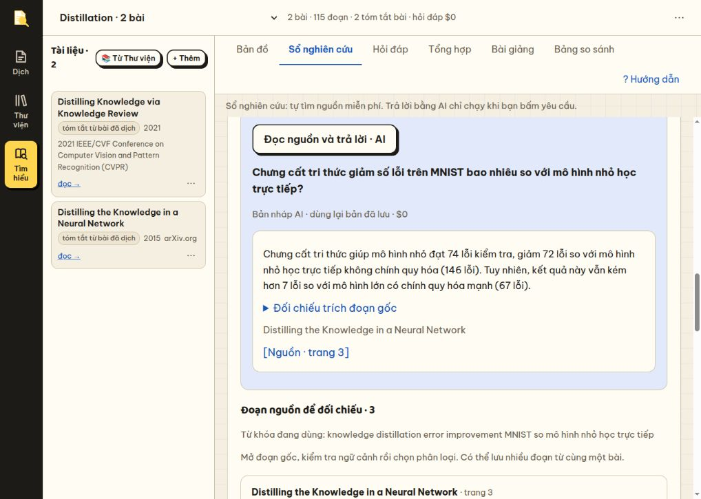

# Báo cáo kiểm tra và bàn giao Loupe

Ngày kiểm tra: 13/10/2026. Repository: `/media/tan/F/my_tool`. Commit nền: `a810b10`, kèm nhiều thay đổi chưa commit. Báo cáo mô tả mã trong working tree, không chỉ mã của commit nền.

## Kết luận để tiếp tục công việc

Chưa đủ cơ sở kết luận mọi tính năng đã được kiểm tra kỹ hoặc câu trả lời nghiên cứu đã đáng tin cậy trên nhiều bài. Bộ kiểm thử hiện tại đạt 333/333. Luồng Sổ nghiên cứu đã hoạt động trên trình duyệt và trả lời đúng một câu hỏi định lượng có nguồn. Tuy nhiên, kiểm tra bổ sung đã tái hiện được lỗi truy hồi sai bộ dữ liệu và việc chấp nhận câu trả lời sai đi kèm trích đoạn thật.

Ưu tiên tiếp theo là độ khớp giữa câu hỏi, câu trả lời và bằng chứng. Chất lượng này cần được đánh giá riêng với độ ổn định API và giao diện. Không nên tăng số tính năng trước khi xử lý các lỗi P1 bên dưới.

## Yêu cầu của người dùng cần giữ

- Trả lời đúng điều được hỏi, có số liệu, đối chứng và điều kiện cần thiết.
- Sửa logic dùng chung để áp dụng cho bài khác. Không chỉ sửa nội dung của bài đang mở.
- Tự động hóa thao tác tra cứu và lưu lại công việc, đồng thời kiểm soát chi phí.
- Ưu tiên model rẻ khi cần kiểm chứng bằng API thật.
- Dùng tiếng Việt nghiêm túc, chính xác. Tránh diễn đạt hình tượng như “hỏng”, “nút thắt cổ chai”, “nhìn vào một tầng”.
- Giữ tên paper gốc trong phần đọc, dịch và thư viện. Giữ logo Loupe đã được người dùng chọn.
- Kiểm tra bằng trình duyệt, có bằng chứng và báo rõ giới hạn kiểm thử.

## Trạng thái vận hành và nguyên nhân trang không phản hồi

| Môi trường | Dữ liệu | Trạng thái trong đợt kiểm tra |
|---|---|---|
| `http://127.0.0.1:8010` / `http://0.0.0.0:8010` | Dữ liệu thật, Docker `my_tool-app-1` | Ban đầu backend chưa nạp API trả lời mới, dù frontend đã mount mã mới. Đã restart sau khi test đạt. Xác minh HTTP 200 và cả GET/POST API trả lời mới trong `runtime.json`. |
| `http://127.0.0.1:8011` | Bản sao SQLite `/tmp/loupe-auto-ui-h1rvev9_/papers.db` | Tiến trình thử trước đó đã dừng. `curl` trả HTTP 000 trong khi trình duyệt vẫn giữ giao diện đã tải. Đã khởi động lại và kiểm tra giao diện. |

Không xác định được nguyên nhân tiến trình 8011 dừng chỉ từ trạng thái hiện tại. Không quy kết đây là lỗi dữ liệu hay lỗi trình duyệt. Server thử phụ thuộc phiên chạy và có thể cần khởi động lại khi bàn giao.

Bản sao 8011 chỉ sao chép SQLite, không phải bản sao đầy đủ các PDF và thư mục ảnh. Không dùng môi trường này để kết luận về tải PDF, ảnh gốc hoặc xuất tài liệu. Không chuyển câu hỏi thử và cache thử về dữ liệu thật.

Lệnh chạy lại bản thử, nếu thư mục tạm còn tồn tại:

```bash
cd /media/tan/F/my_tool
PAPER_DATA_DIR=/tmp/loupe-auto-ui-h1rvev9_ \
LAYOUT_BACKEND=off EMBED_BACKEND=off RERANK_BACKEND=off META_LOOKUP=off \
.venv/bin/uvicorn server.main:app --host 127.0.0.1 --port 8011
```

Nếu 8011 đã có tiến trình phục vụ, kiểm tra tiến trình trước khi chạy thêm. Mã backend ở 8010 cần `docker compose restart app` sau khi thay đổi. Sửa frontend cần tải lại trang.

## Những thay đổi đã có trong mã

| Thành phần | Hành vi hiện tại |
|---|---|
| Tra cứu câu hỏi | Tự tìm nguồn khi lưu hoặc chọn câu hỏi. Đổi thuật ngữ Việt sang Anh bằng glossary của các bài trong đúng kho. |
| Chọn đoạn nguồn | Tìm trong chữ gốc và tiêu đề mục. Loại nguồn chỉ khớp tiêu đề paper hoặc bản dịch. Ưu tiên mục có đúng tên bộ dữ liệu và dấu hiệu phù hợp loại câu hỏi. |
| Trích đoạn | Hiển thị tối đa 480 ký tự quanh từ khóa hoặc số liệu. Đầu vào cho AI dùng đoạn dài hơn, tối đa 1.400 ký tự mỗi nguồn. |
| Trả lời AI | Một lời gọi ứng dụng tới model nhanh, tối đa 1.800 token đầu ra. Trả câu trả lời, mã nguồn, trích đoạn và phần thông tin còn thiếu. |
| Kiểm trích dẫn | Mã nguồn phải thuộc tập đã cấp cho model. Trích đoạn 30–600 ký tự phải xuất hiện trong nguồn sau chuẩn hóa khoảng trắng. |
| Chi phí | Tra giá trước khi gọi, từ chối nếu chưa có giá hoặc ước tính vượt $0,02. Chỉ POST do người dùng yêu cầu mới sinh câu trả lời. |
| Cache câu trả lời | Lưu theo câu hỏi, model, luật trả lời và dữ liệu nguồn. GET chỉ đọc kết quả còn khớp, không gọi model. Mở lại câu hỏi tự hiện bản đã lưu. |
| Thao tác bằng chứng | Đổi phân loại giữ nhận xét. Tự lưu nhận xét theo hàng đợi. Kết quả đến trễ sau khi đổi kho/câu hỏi bị bỏ qua. |
| Giao diện | Hiện câu hỏi ngay cạnh câu trả lời, giữ tên paper gốc, mở trích đoạn và liên kết tới đoạn trong màn đọc. |

Các phép tìm nguồn miễn phí vẫn là heuristic. Nhãn loại thông tin trong đoạn không có nghĩa đoạn đó đã hỗ trợ kết luận.

## Bằng chứng kiểm thử

| Phép kiểm | Kết quả | Giới hạn |
|---|---|---|
| `.venv/bin/python -m pytest -q` | 333 passed, 184,97 giây | Kiểm thử logic/API hiện có. Không đo đầy đủ chất lượng nghiên cứu. |
| `node tests/test_research_ui.cjs` | Đạt | Dùng DOM và mạng giả lập. Không thay được kiểm tra bố cục thật. |
| `node --check` cho `app.js`, `survey.js`, `sv-research.js` | Đạt | Chỉ xác minh cú pháp. |
| 7 mục Sổ nghiên cứu trên kho Distillation | Đã mở và đọc trạng thái thực tế | Không chạy đủ mọi biến thể dữ liệu và kích thước màn hình. |
| Nút nguồn của câu trả lời | Mở đúng `p62afa96786c19`, trang 3, mục MNIST | Liên kết tới `#doc=ef54fccdde13&khoi=b30` có trong bảng nguồn. |
| Mở lại câu hỏi sau tải lại trang | Bản trả lời tự hiện, ghi dùng cache và $0 | Đã kiểm một câu hỏi trên bản sao dữ liệu. |
| Các tab Bản đồ, Hỏi đáp, Tổng hợp, Bài giảng, Bảng so sánh | Mở được ở chế độ chỉ đọc | Không gọi mới các luồng sinh nội dung này trong đợt bàn giao. |
| Các phép thử đối kháng miễn phí | Tái hiện 5 giới hạn, xem bên dưới | Dữ liệu giả lập trong thư mục tạm, không gọi model. |

Log và hiện vật nằm trong [thư mục bằng chứng](loupe-research-audit-2026-10-13/): `pytest.txt`, `frontend.txt`, `probes.json`, `reproduce.py`, `ui-sections.json`, `ui-other-tabs.json`, `answer.png`, `runtime.json`.

### Ví dụ đã gọi model thật

Câu hỏi: “Chưng cất tri thức giảm số lỗi trên MNIST bao nhiêu so với mô hình nhỏ học trực tiếp?”

Sau sửa, câu trả lời nêu 146 xuống 74 lỗi, tức giảm 72 lỗi, dẫn trang 3 của *Distilling the Knowledge in a Neural Network*. Nguồn thực sự chứa mô hình nhỏ có hai tầng ẩn, 800 đơn vị mỗi tầng, và temperature 20.

Hai bản kết quả đã lưu dùng `qwen/qwen3.7-flash`, chi phí do API báo lần lượt $0,00007359 và $0,000066448, tổng $0,000140038. Đây là chi phí của hai lần thử này, không phải giá cố định cho mọi câu hỏi. Đợt rà soát bàn giao chỉ đọc lại cache và không phát sinh lời gọi model mới.

Câu trả lời thử vẫn chưa chủ động nêu đủ các điều kiện 800 đơn vị/tầng và temperature 20. Kết quả đúng về phép so sánh chính, nhưng chưa đạt chuẩn câu trả lời thực nghiệm đầy đủ.



## Các vấn đề còn tồn tại

P1 là vấn đề ảnh hưởng trực tiếp độ đúng hoặc khả năng sử dụng để nghiên cứu. P2 là vấn đề về hiệu quả, chi phí và độ rõ của giao diện. Các mục dưới đây chưa được sửa trong đợt lập báo cáo.

### P1-01. Trích đoạn thật vẫn có thể đi cùng câu trả lời sai

Vị trí: `server/survey/research.py::_validated_findings`.

Đã tái hiện bằng nguồn có 74 và 146 lỗi. Đưa vào câu trả lời “Mô hình đạt 999 lỗi và kém hơn đối chứng”, kèm nguyên văn nguồn thật. Hàm vẫn chấp nhận. Xem `wrong_answer_with_real_quote_accepted=true` trong `probes.json`.

Nguyên nhân là hàm chỉ kiểm mã nguồn, độ dài và sự tồn tại của trích đoạn. Nó chưa kiểm con số của câu trả lời, chiều so sánh, bộ dữ liệu, đối chứng hoặc quan hệ hỗ trợ về ý nghĩa. Prompt không thay thế được các phép kiểm này.

Hướng sửa: dùng biểu diễn có cấu trúc cho giá trị, độ đo, đối chứng, bộ dữ liệu và điều kiện. Tính chênh lệch bằng code khi đủ dữ kiện. Xem khả năng tái sử dụng `server/survey/verify.py` thay vì dựng một hệ kiểm tra độc lập. Bộ kiểm số phải phân biệt số có trong nguồn với số suy ra hợp lệ như `146 - 74 = 72`.

Tiêu chí đạt: chặn hoặc đánh dấu cần kiểm tra với 999 lỗi, đảo chiều tốt/xấu, tráo đối chứng và tráo bộ dữ liệu. Vẫn chấp nhận phép tính 72 khi hai toán hạng có nguồn. Đánh giá riêng trường hợp trích dẫn đúng nhưng không trả lời câu hỏi.

### P1-02. Lọc bộ dữ liệu phụ thuộc metadata, có cả lấy sai và bỏ sót

Vị trí: `_dataset_names`, `suggest`, `search_query`.

Đã tái hiện hai trường hợp:

1. Kho chưa có MNIST trong `card.datasets` hoặc entity. Hỏi `distillation MNIST results` vẫn trả đoạn về ImageNet vì cùng khớp từ distillation/results.
2. Metadata có MNIST nhưng đoạn và tiêu đề mục không nhắc MNIST. Đoạn có kết quả bị loại, dù có thể thuộc thí nghiệm đang hỏi. Phép thử thứ hai chứng minh việc loại nguồn theo chuỗi, chưa chứng minh đoạn đó thực sự hỗ trợ câu hỏi.

Hướng sửa: tách câu hỏi thành đối tượng, dữ liệu, độ đo và điều kiện. Giữ ngữ cảnh mục và đoạn lân cận khi chọn nguồn. Metadata chỉ giúp mở rộng ứng viên, không tự biến một đoạn thành bằng chứng. Khi thiếu dấu hiệu đúng bộ dữ liệu, trả trạng thái chưa đủ căn cứ.

Tiêu chí đạt: không trả kết quả ImageNet như kết quả MNIST khi metadata thiếu. Có thể tìm nguồn cần ngữ cảnh liền kề, đồng thời ghi rõ nguồn nào cung cấp tên dữ liệu. Bao phủ câu hỏi so sánh hai bộ dữ liệu, bí danh và câu hỏi tiếng Việt không có glossary.

### P1-03. Bảng thực nghiệm chưa hữu ích với bài nhập từ phần Dịch

Đã quan sát trên kho Distillation. Hai hàng có phần mô tả dài, nhưng các cột Dữ liệu, Độ đo, Đối chứng và Giá trị đều là dấu “—”. Một hàng chứa nhiều kết quả MNIST, ASR, JFT trong cùng đoạn mô tả, gắn nguồn trang 1.

Giao diện đã cảnh báo cần đối chiếu, nhưng người dùng vẫn chưa có bảng định lượng để nghiên cứu. Nguồn trang 1 không đủ để suy ra toàn bộ các số liệu nằm ở nhiều phần của bài.

Hướng sửa: sửa bước chuyển brief sang card và trích kết quả thành từng thí nghiệm. Mỗi hàng cần giá trị, độ đo, dữ liệu, split, mô hình đối chứng, điều kiện và nguồn cụ thể. Không gán một nguồn chung cho nhiều số liệu chưa kiểm.

Tiêu chí đạt: trường hợp MNIST có hàng riêng cho 146 và 74, đúng nguồn trang 3. Điều kiện khác nhau không bị đánh dấu so sánh trực tiếp. Chưa có số liệu phải hiện yêu cầu bổ sung nguồn, thay vì tạo hàng kết quả giả đầy đủ.

### P1-04. Nội dung cũ còn vi phạm yêu cầu văn phong và thiếu nguồn

Trong Khoảng trống của *Distilling Knowledge via Knowledge Review*, giao diện vẫn hiện “nút thắt cổ chai”. Người dùng đã yêu cầu tránh cách diễn đạt này. Các nhận định về giới hạn đang lấy từ phiếu và chưa gắn đoạn nguồn.

Đây là dữ liệu đã lưu. Sửa prompt cho lần sinh sau không tự sửa brief/card cũ. Không thay từ hàng loạt vì có thể làm sai nghĩa khoa học. Cần thiết kế bước rà soát nội dung cũ có xem trước, giữ nguồn và chỉ cập nhật phần được xác minh.

Tiêu chí đạt: nội dung diễn đạt trực tiếp cơ chế hoặc giới hạn. Tách điều tác giả phát biểu với điều hệ thống suy luận. Không dùng nhãn “giới hạn tác giả nêu” nếu chưa có đoạn nguồn tương ứng.

### P2-01. Cache có thể mất hiệu lực vì điểm xếp hạng thay đổi

Vị trí: `answer_question`, đoạn tạo `passages` từ toàn bộ trường của hit rồi đưa vào payload/hash.

`score` BM25 là một phần payload. Phép thử thêm tài liệu không liên quan cho thấy cùng mã nguồn nhưng điểm đổi từ `-1e-06` thành `-1.6268271711092006e-06`. Vì vậy khóa cache đổi dù phần nguồn được đọc vẫn như cũ. Người dùng có thể phải trả phí tạo lại không cần thiết.

Hướng sửa: tạo payload nội dung ổn định, chỉ gồm câu hỏi, nguồn thực sự gửi, metadata cần thiết, model và phiên bản luật. Tách điểm truy hồi khỏi nội dung cache. Không bỏ điều kiện vô hiệu cache khi nguồn thực sự đổi.

Tiêu chí đạt: thêm tài liệu không liên quan không làm mất cache khi tập nguồn và nội dung trả lời không đổi. Sửa nguồn, câu hỏi hoặc model vẫn làm mất cache.

### P2-02. Chi phí và thời gian chờ chưa được theo dõi đầy đủ

Kiểm tra mã cho thấy `sdb.stats().spent` chỉ cộng bảng `run`. Chi phí `research_answer` không được tính vào thống kê này. `Usage.cost` mặc định là 0.0, nên nhánh dự phòng `cost is None` chưa xử lý trường hợp nhà cung cấp không trả chi phí.

Mức $0,02 là ngưỡng ước tính cho yêu cầu, không phải hạn mức tích lũy. Khóa `asyncio.Lock` chỉ bảo vệ trong một process và chưa được giải phóng khỏi dictionary theo vòng đời kho. UI chưa có hủy yêu cầu hoặc thông tin thời gian chờ. GET đọc cache còn dùng chung khóa với POST đang sinh nội dung, nên có thể phải chờ model.

Hướng sửa: lưu riêng chi phí thực, chi phí ước tính và trạng thái chưa biết. Thêm theo dõi tổng chi phí nghiên cứu. Giữ chống bấm lặp, đánh giá trường hợp nhiều tab/process, và kiểm tra chính sách retry của lớp LLM. Tách đọc cache khỏi thời gian chờ sinh câu trả lời nếu có thể.

Các tình huống nhiều process, timeout nhà cung cấp và retry trả phí chưa được tái hiện trong đợt này.

### P2-03. Không có nguồn vẫn có thể hiển thị nhãn Bản nháp AI

GET đọc cache khi không tìm thấy đoạn nguồn trả một object với `cached=false`, chi phí 0 và findings rỗng. UI gọi cùng hàm dựng kết quả AI. Do đó có thể hiện nhãn Bản nháp AI dù không gọi model.

Hướng sửa: trả trạng thái rõ như `no_sources`, `cached`, `generated`, `generation_failed`. Chỉ hiện nhãn AI với kết quả thực sự được sinh. Không suy ra trạng thái từ chi phí bằng 0.

### P2-04. Tính năng quan hệ và gợi ý câu hỏi chưa dùng chung nguồn metadata

`_dataset_names` đã đọc cả card và entity, nhưng `_relations` chỉ đọc `card.datasets`. Với bài nhập từ phần Dịch, quan hệ có thể rỗng dù entity đã có thông tin hữu ích. Đây là nhận xét từ mã. Chưa kết luận kho Distillation nhất thiết phải có quan hệ tập dữ liệu chung.

Gợi ý câu hỏi dừng ở ba tên đầu tìm được và hiện đều lấy từ bài đầu trong kho thử. Cần phân bổ theo bài, độ bao phủ nguồn và câu hỏi đang nghiên cứu. Giữ nhãn quan hệ chủ đề, không tự suy ra đồng thuận, mâu thuẫn hay kế thừa.

### P2-05. Phạm vi kiểm thử UI và nội dung còn hẹp

Kiểm thử JS dùng đối tượng DOM giả. Chưa có bộ kiểm tự động thao tác trình duyệt với nhiều kích thước màn hình, thao tác phím, mất mạng, hai tab hoặc lưu khi chuyển trang. Đợt bàn giao chưa kiểm lại toàn bộ slide, trình chiếu, xuất HTML/PPTX và vòng nạp PDF → confirm → translate.

Các câu hỏi trên kho lớn, nguồn mâu thuẫn, phần phụ lục, số liệu trong bảng/ảnh, và truy vấn cần nhiều đoạn chưa có bộ đánh giá có đáp án chuẩn. Không dùng kết quả một câu MNIST để đại diện cho các nhóm này.

## Thứ tự cải thiện đề xuất

1. Tạo bộ đánh giá tối thiểu 20–30 câu có đáp án và nguồn chuẩn. Bao gồm câu có đủ nguồn, thiếu nguồn, phủ định, so sánh, nhiều điều kiện và nguồn mâu thuẫn.
2. Sửa P1-01 và P1-02. Đo đúng nguồn được truy hồi, độ đúng câu trả lời, độ đầy đủ điều kiện và khả năng từ chối khi thiếu căn cứ.
3. Sửa P1-03 ở bước tạo dữ liệu. Sau đó hoàn thiện giao diện bảng thực nghiệm.
4. Xử lý nội dung cũ theo nguồn và yêu cầu văn phong. Không xóa toàn bộ cache của người dùng để thử prompt.
5. Sửa khóa cache, thống kê chi phí và trạng thái xử lý. Giữ tra cứu miễn phí và tránh tự gọi model khi tải trang.
6. Mở rộng kiểm thử trình duyệt trên các luồng quan trọng và chạy lại hồi quy.

Các ngưỡng chất lượng cho bộ đánh giá cần được thống nhất sau khi có dữ liệu chuẩn. Chưa có số đo đủ để tuyên bố tỷ lệ trả lời đúng hiện tại.

## Điểm vào mã cho agent tiếp theo

| File | Vai trò |
|---|---|
| `server/survey/research.py` | CRUD ghi chép, 7 bảng tổng hợp, truy hồi, prompt trả lời, kiểm trích dẫn và cache. |
| `server/survey_api.py` | `/research`, `/research/suggest`, GET/POST `/research/answer/{qid}`, CRUD `/research/items`. |
| `server/survey/db.py` | Bảng `research_item`, `research_answer`, BM25 có chế độ `source_only`, thống kê chi phí. |
| `web/sv-research.js` | Trạng thái UI, tự tìm nguồn, đọc cache, hiển thị câu trả lời, lưu nhận xét. |
| `web/index.html`, `web/survey.css` | Cấu trúc và bố cục Sổ nghiên cứu. |
| `web/survey.js` | Mở kho, đổi tab, hiển thị giá và thống kê, mở nguồn. |
| `server/survey/verify.py`, `server/depth.py` | Cơ chế kiểm câu trả lời và độ sâu sẵn có để đánh giá khả năng tái sử dụng. |
| `tests/test_research.py` | Kiểm API, truy hồi, giới hạn kho, cache và chặn trích dẫn giả. |
| `tests/test_research_ui.cjs` | Kiểm tìm nguồn, đổi nhãn, tự lưu, chống kết quả trễ và chống gọi lặp. |

Bốn file `research.py`, `sv-research.js`, `test_research.py`, `test_research_ui.cjs` đang là untracked tại lúc lập báo cáo. Các file khác có nhiều thay đổi từ công việc trước. Không reset/checkout toàn repo hoặc gộp tất cả vào một commit mà chưa xem diff.

## Lệnh kiểm chứng và hàng rào dữ liệu

```bash
cd /media/tan/F/my_tool
.venv/bin/python -m pytest -q
node tests/test_research_ui.cjs
node --check web/app.js
node --check web/survey.js
node --check web/sv-research.js
.venv/bin/python docs/reports/loupe-research-audit-2026-10-13/reproduce.py
git diff --check
```

`reproduce.py` in JSON mô tả giới hạn hiện tại. Giá trị `true` ở các trường lỗi nghĩa là đã tái hiện lỗi, không có nghĩa hệ thống đạt yêu cầu. Sau sửa cần cập nhật kỳ vọng và chuyển các ca phù hợp thành test hồi quy.

Giữ `tests/conftest.py` đặt `PAPER_DATA_DIR` ở cấp module trước khi nạp module `server`. Không chuyển sang fixture. Test API không được gọi model thật. Script tái hiện cũng đặt dữ liệu tạm trước khi nạp module và dùng khóa giả.

Không chạy `DELETE FROM tm` hoặc `DELETE FROM parse_cache` trên dữ liệu thật để kiểm thay đổi này. Không sửa `cached_prefix` của luồng dịch. Đọc đầy đủ `AGENTS.md` trước khi sửa bước nạp, FTS5, dịch, slide hoặc dữ liệu card.

## Nội dung giao việc có thể gửi cho agent tiếp theo

> Đọc `AGENTS.md` và báo cáo này, sau đó tái hiện P1-01/P1-02 bằng script miễn phí. Ưu tiên sửa độ khớp giữa câu hỏi, câu trả lời và nguồn trong logic dùng chung. Tạo bộ đánh giá nhiều câu, giữ dữ liệu thật và các thay đổi chưa commit. Trả lời phải đúng đối chứng, dữ liệu, độ đo và điều kiện. Thiếu căn cứ phải nêu rõ. Giữ chi phí thấp, không tự sinh nội dung khi tải trang. Hoàn thành bằng test hồi quy, kiểm trình duyệt và cập nhật báo cáo với bằng chứng trước/sau.
